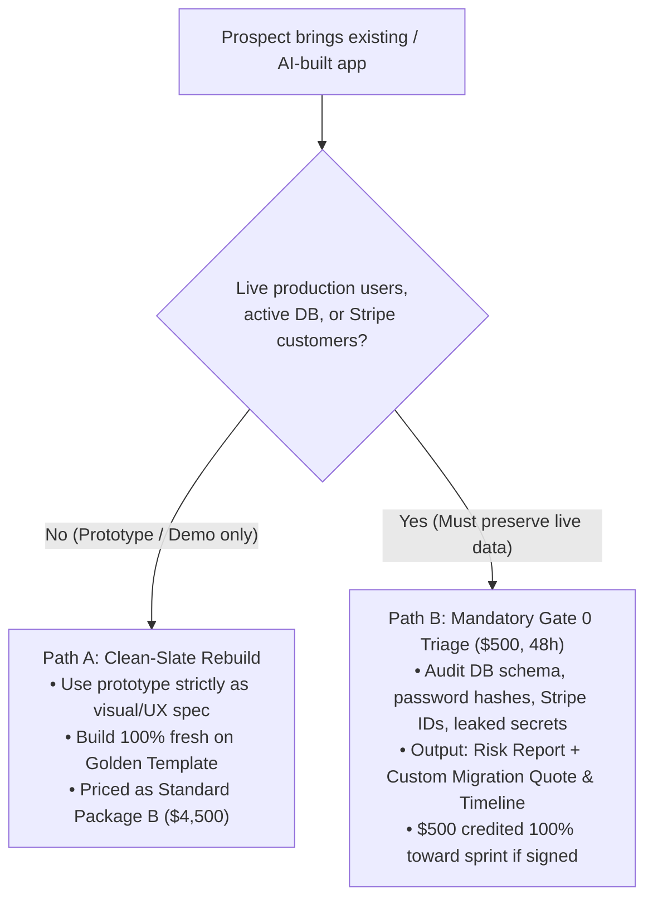

# Internal Offering Architecture Map & Delivery Blueprint

> **Audience:** Internal `[Studio Name]` engineering team (4 members).  
> **Purpose:** Map **100% of [OFFER_CATALOG.md](./OFFER_CATALOG.md)** to exact technical defaults, repository structure, OpenTofu modules, test gates, and known pitfalls so everyone scopes, estimates, and builds consistently.

---

## 1. Golden Template Defaults (Standardized Stack)

Every sprint forks one of two standardized templates — **never** invent a new framework per client unless explicitly contracted.

| Layer | Variant 1: Unified TypeScript *(Default Pkg B)* | Variant 2: High-Performance `.NET 10` *(Default Pkg C / Opt Pkg B)* |
| :--- | :--- | :--- |
| **Frontend** | Next.js (App Router) + TypeScript + Tailwind CSS + Shadcn UI | Vite + React + TypeScript *(SPA)* or Next.js *(if SSR/SEO needed)* |
| **Backend API** | Next.js Server Actions / Route Handlers *(or standalone Hono/Fastify)* | **ASP.NET Core `.NET 10`** (Minimal APIs + TypedResults + Scalar/Swagger) |
| **ORM & DB** | **Drizzle ORM** + PostgreSQL 16 | **EF Core 10** + PostgreSQL 16 |
| **Auth** | **BetterAuth** *(self-hosted in Postgres: Google OAuth + Magic Link, zero MAU fee)* | ASP.NET Identity / JWT + Cookie or BetterAuth BFF |
| **Payments & Email** | Stripe Checkout / Lemon Squeezy + **Resend** | Stripe.NET + **Resend** |
| **Cache / Real-Time** | Redis 7 + Server-Sent Events (SSE) | Redis 7 + **SignalR** / SSE |
| **Runtime & Proxy** | Docker Compose + **Caddy** (auto-HTTPS) | Docker Compose + **Caddy** (auto-HTTPS) |
| **Testing Gate** | Vitest + Playwright (smoke) + Supertest/API integration tests | xUnit + `WebApplicationFactory` + Testcontainers (Postgres) |

### Standard Monorepo Layout

```text
client-app/
├── apps/
│   ├── web/                 # Next.js or Vite+React SPA
│   └── api/                 # ASP.NET Core .NET 10 (omitted in Unified TS)
├── infra/
│   └── tofu/                # Parameterized OpenTofu (hetzner | digitalocean | aws) + remote S3/R2 state backend
├── docker-compose.yml       # Local Postgres 16 + Redis 7 + Mailpit
├── .github/workflows/       # ci.yml (PR test gate), provision-infra.yml (manual OpenTofu), deploy-app.yml (ghcr.io rollout)
└── README.md                # Standardized runbook + restore instructions
```

### Two-Workflow CI/CD & Remote State Rule *(Prevents Day 30 Token-Revocation Breakage)*

* **`provision-infra.yml` (`workflow_dispatch` manual trigger):** Runs `tofu init` & `tofu apply` storing `terraform.tfstate` in the **client’s encrypted S3 / Cloudflare R2 bucket** (never committed to git or left on a local laptop). Uses the temporary Cloud Admin API Token during Stage 4 setup.
* **`deploy-app.yml` (`push` to `main` after `ci.yml` passes):** Builds the Docker image, pushes to `ghcr.io`, and triggers container rollout on the server via a **scoped SSH/webhook deploy key**. Because it does *not* call `tofu apply`, the client can safely revoke their root Cloud Admin API Token at the end of Day 30 without breaking future `git push` deployments!

---

## 2. Base Packages Technical Mapping

| Package | Stack Variant | Concurrency & Infra Architecture | Mandatory Automated Test Gate |
| :--- | :--- | :--- | :--- |
| **Package A** *(API & Cloud, $2k, 7–10d)* | `.NET 10` or Node/TS API | Single-node VPS (`~500` concurrent), Docker + Caddy + Postgres + Redis + `/api/health` + daily `pg_dump` | Auth/JWT tests, core CRUD integration tests against real Postgres, OpenAPI schema check |
| **Package B** *(30-Day MVP, $4.5k, 30d)* | Unified TS *(default)* or `.NET 10` | Same single-node hardened layout (`~500` concurrent) + staging sandbox (`staging-*`) prior to Day 30 cutover | Auth flow, Stripe webhook signature + DB plan sync test, primary CRUD flow, Playwright smoke check |
| **Package C** *(Fintech / Real-Time, $8k–$12k, 30–45d)* | `.NET 10` *(mandatory)* | **Horizontally scalable (`1,000–5,000+` concurrent):** Load Balancer + 2+ stateless app replicas + **PgBouncer** + Redis Pub/Sub + structured audit log table | Everything in B + RBAC isolation tests + SignalR/WS concurrency test + **k6 / NBomber** p99 latency & RPS report |

---

## 3. Architecture Configurator Decision Guide

### Step 1: Frontend Pattern

* **Option 1 — SEO / Public SaaS (`Next.js SSR/SSG`):** Choose when public pages, landing content, dynamic `/[slug]` pages, or OpenGraph previews drive acquisition.
* **Option 2 — App / Dashboard SPA (`Vite + React`):** Choose when behind-login speed, dense tables/charts, and complex client state matter more than Google indexing. *(Fastest pairing with `.NET 10` API.)*
* **Option 3 — Real-Time Collaborative (`SSE / WebSockets / SignalR`):**
  * Use **SSE** for unidirectional live feeds/dashboards/AI token streaming (works over standard HTTP/2 through Caddy with zero socket headaches).
  * Use **SignalR / WebSockets** only when bi-directional client-to-client state sync is required.

### Step 2: Backend Engine

* Steer to **Unified TypeScript** for standard SaaS CRUD (faster single-language velocity across all 4 team members).
* Steer to **ASP.NET Core `.NET 10`** when the client has heavy numeric/financial math, strict type contracts, high concurrency, SignalR, or enterprise compliance preferences.

### Step 3: OpenTofu Cloud Modules (`infra/tofu/`)

| Target | Provisioned Resources | Required Client Secrets | Team Effort & Caveats |
| :--- | :--- | :--- | :--- |
| **`modules/hetzner`** *(Included)* | `hcloud_server` (Ubuntu 24.04, CX22+), `hcloud_firewall` (`80/443` only, SSH restricted), Cloudflare DNS + R2/S3 backup cron | `HCLOUD_TOKEN`, `CLOUDFLARE_API_TOKEN`, R2/S3 keys | **~30 min deploy.** Default choice for bootstrapped founders (~€4–€20/mo). |
| **`modules/digitalocean`** *(Included)* | `digitalocean_droplet` + `digitalocean_firewall` (or optional DO Managed Postgres) + Spaces backup cron | `DIGITALOCEAN_TOKEN`, `CLOUDFLARE_API_TOKEN` | **~45 min deploy.** Watch DO Managed DB minimum ($15/mo) vs container Postgres. |
| **`modules/aws`** *(+$700 on A/B; Incl. in C)* | VPC (public/private subnets), NAT/Security Groups, ECS Fargate or EC2 + ALB, RDS PostgreSQL, IAM deploy role, S3 backup bucket | Scoped `AWS_ACCESS_KEY_ID` / `AWS_SECRET_ACCESS_KEY` (`studio-deployer`) | **~0.5–1.5 days deploy & IAM debug.** Never include free on Package B — charge the +$700 add-on. |

---

## 4. Modular Add-Ons Technical Blueprint & Gotchas

| Add-On | Exact Implementation Pattern | Key Risk / Trap to Prevent |
| :--- | :--- | :--- |
| **Additional Screens** *(+$400)* | 1 Route + Shadcn view + 1–2 typed API endpoints + validation | Confirm the screen uses existing DB entities; new entities/workflows count as separate scope. |
| **Multi-Tenancy & RBAC** *(+$900)* | `organizations`, `memberships` (`owner`/`admin`/`member`/`viewer`), invite token table, scoped middleware injecting `orgId` | **Critical Trap:** Every DB query MUST filter by `orgId` from verified session — test cross-tenant access (`403`) in integration tests! |
| **Marketplace / Stripe Connect** *(+$1,200)* | Stripe Connect Express accounts, `account.updated` webhook, `application_fee_amount` split on Checkout | **Critical Trap:** Seller KYC verification depends on Stripe's test/live flow; use Express (never Custom Connect) so Stripe hosts KYC UI. |
| **Admin Super-Dashboard** *(+$800)* | Role-gated `/admin` layout, user/org search, plan override flag, webhook retry/audit table | Never expose `/admin` routes without strict server-side `isSuperAdmin` guard + audit log entry. |
| **UI/UX Design Pack** *(+$800)* | Custom Tailwind theme tokens + Shadcn component spec + low-fi Figma/Excalidraw wireframes approved before Week 2 | Lock wireframe approval in Week 1 before coding; do not start UI build on unapproved designs. |
| **High-Concurrency & Load-Test** *(+$1,500)* | Load Balancer + 2+ stateless replicas + **PgBouncer** (`transaction` mode) + Redis response/session cache + **k6 / NBomber** script | **Critical Trap:** Disable prepared statements when using PgBouncer transaction pooling (`prepare: false` in Drizzle / Npgsql pooling config). |
| **AI / LLM Pipeline** *(+$1,000)* | Server-side OpenAI/Anthropic SDK streaming via SSE, `ai_usage_logs` table, per-user rate/token quota cap | **Critical Trap:** Never stream directly from browser; enforce token budgets server-side so a user cannot burn the client's API key. |
| **RAG / Document Search** *(+$1,400)* | S3/R2 file upload → background extraction (`pdf-parse`/PdfPig) → fixed-overlap chunking → **`pgvector`** HNSW index + cosine search | **Critical Trap:** Large PDFs timeout HTTP requests — parsing & embedding MUST run asynchronously in a worker, not inside the upload request! |
| **Background Workers & Cron** *(+$700)* | Redis-backed **BullMQ** (Node) or **`BackgroundService` / Hangfire/Quartz** (`.NET 10`) + dead-letter logging | Ensure jobs are **idempotent** (safe to retry without duplicate emails or double charges). |
| **3rd-Party API / Webhook Sync** *(+$600)* | Typed client wrapper + exponential backoff retry + HMAC signature verification + inbound webhook log table | Always validate incoming webhook signatures and return `200 OK` quickly before heavy async processing. |

---

## 5. Existing / AI-Generated Codebase Policy *(Debt Protection)*

> **Core Rule:** We **never** patch or inherit an existing Lovable / v0 / Cursor / Bolt backend, auth system, or database schema inside a fixed-price sprint. Technical debt in AI-generated codebases is almost always heavier and slower to debug than building clean from our Golden Template.



### Gate 0: 48-Hour Triage Checklist ($500 USD)

Only triggered when live production data or code **must** be preserved:

1. **Secrets & Security Scan:** Check git history/client bundle for exposed API keys, broken RLS policies, or hardcoded credentials.
2. **Database & Migration Audit:** Inspect live row counts, missing foreign keys, orphan records, and schema drift.
3. **Auth Compatibility Check:** Verify password hashing algorithm (`bcrypt`/`argon2`/Supabase Auth UUIDs) and whether users can migrate silently or require a forced password reset.
4. **Billing Continuity:** Map live `stripe_customer_id` / `stripe_subscription_id` records to preserve active billing without double-charging users.
5. **Deliverable:** A 2-page **Migration Risk & Effort Report** + exact fixed-price migration addendum (credited `$500` upon SOW signing).

---

## 6. Post-Launch Care Retainer Runbooks

### Peace of Mind (`$450 / mo` — ~1–2 hrs/mo workload)

* **Automated (24/7):** BetterStack `/api/health` + DB ping alerting to studio Discord; midnight encrypted `pg_dump` to R2/S3.
* **Monthly Manual Check (30 mins on 1st Monday):**
  1. Test-restore latest `pg_dump` into a disposable local container to verify backup integrity.
  2. Apply OS security patches (`unattended-upgrades` check + Docker base image updates).
  3. Verify SSL certificate auto-renewal and disk/RAM utilization (`<70%`).
  4. Send client a 3-line *"Monthly System Health: 100% Uptime, Backups Verified"* email.

### Growth Sprint (`$1,500 / mo`)

* Everything in *Peace of Mind* + **10–15 tracked engineering hours/month** for incremental features, prioritized in a shared GitHub Project board with PR reviews and staging verification before production deploy.
