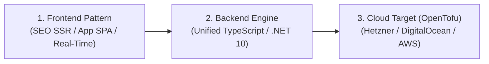
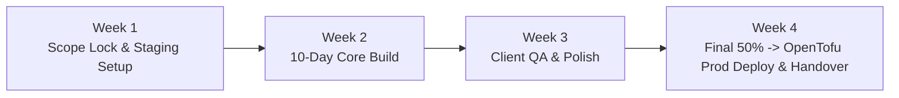

# [Studio Name] — Productized Engineering Catalog

**Production-Ready Web, API & Cloud Systems Delivered in 30 Days.**  
*Contact: `[hello@studio.dev]` | Live Showcase: `[https://demo.studio.dev]` | Book a Call: `[Cal.com Link]`*

---

## Why [Studio Name]

* **Fixed Scope, Fixed Price:** No hourly billing surprises or multi-month agency drag.
* **30-Day Delivery Window:** Powered by our 14-day rapid build framework with built-in review, QA, and polish buffers.
* **100% Client Ownership (Zero Lock-In):** You own your custom codebase, database, and cloud account from day one of production.
* **Automated Cloud Infrastructure (OpenTofu):** We provision hardened VPCs, PostgreSQL, SSL, CI/CD, and daily encrypted backups directly into *your* AWS, DigitalOcean, or Hetzner account.
* **Staging-First Security:** All development runs in our isolated staging sandbox; production deployment and repository transfer happen cleanly upon final sign-off.

---

## 1. Base Packages

### Package A: API & Cloud Foundation Sprint

*Ideal for teams with an existing frontend/mobile app, or founders needing a hardened backend and cloud pipeline fast.*

* **Timeline:** 7–10 Days
* **Investment:** **$2,000 USD**
* **What’s Included:**
  * Relational database schema & automated migrations (**PostgreSQL**) + **Redis** caching
  * Production REST / OpenAPI backend (**ASP.NET Core `.NET 10`** or **Node.js / TypeScript**)
  * Authentication & JWT / session security
  * Automated unit & integration test suite on core endpoints
  * Interactive **Swagger / OpenAPI** documentation
  * **OpenTofu** IaC module + GitHub Actions CI/CD + 10-minute Loom walkthrough
  * 14-day post-launch bug warranty

---

### Package B: The 30-Day Production MVP Sprint *(Flagship)*

*Ideal for non-technical founders, pre-seed startups, and design agencies going from Figma/spec to live paying users.*

* **Timeline:** 30-Day Delivery Window *(14 active build days + feedback, QA & handover buffer)*
* **Investment:** **$4,500 USD** *(Founding Client Introductory Rate: $3,000–$3,500 for first case studies)*
* **What’s Included:**
  * **Up to 5 Core Screens** + **1 Primary End-to-End User Workflow**
  * Choice of Rendering Pattern (SEO SSR, Interactive SPA, or Real-Time)
  * Authentication (**Google OAuth + Email / Magic Link**) & user profile management
  * Payments & subscriptions (**Stripe Checkout** or **Lemon Squeezy** + webhook sync)
  * Transactional emails (**Resend**: welcome, receipts, auth links)
  * **PostgreSQL** database + automated daily encrypted backups
  * Unit & integration test suite covering critical business flows
  * Isolated staging environment during build → Day 30 **OpenTofu** production deploy to client’s cloud
  * 100% IP & GitHub repository transfer + `README` runbook + 10-minute Loom walkthrough
  * **14-day post-launch bug warranty**

---

### Package C: High-Throughput / Fintech & Real-Time Sprint

*Ideal for data-heavy SaaS, trading/analytics portals, or collaborative real-time applications.*

* **Timeline:** 30–45 Days
* **Investment:** **$8,000 – $12,000 USD** *(Scoped by concurrency and integration complexity)*
* **What’s Included:**
  * Everything in **Package B**, plus:
  * High-throughput **ASP.NET Core (`.NET 10`)** API + **Redis Pub/Sub** & WebSockets / SSE / SignalR
  * **Up to 8 Core Screens** + Workspace Role-Based Access Control (**RBAC**)
  * Background job workers & async queue processing
  * Audit logging, rate limiting, and load/latency verification report
  * Hardened VPC networking + automated health & uptime alerting

---

## 2. Architecture Configurator *(3-Step Discovery Call Flow)*

Every Package B or C build is tailored using these three architectural choices:

| Layer | Option 1 | Option 2 | Option 3 |
| :--- | :--- | :--- | :--- |
| **1. Frontend Pattern** | **SEO / Public SaaS** *(Next.js SSR/SSG)* — Best for marketplaces, public content, Google indexing, and OpenGraph cards | **App / Dashboard SPA** *(Vite + React + TypeScript)* — Best for private B2B tools, portals, and zero-flicker client state | **Real-Time Collaborative** *(Next.js/React + WebSockets/SSE)* — Best for live feeds, chat, and instant notifications |
| **2. Backend Engine** | **Unified TypeScript** *(Next.js API / Node + Drizzle/Prisma)* — Fastest iteration in a single TypeScript codebase | **High-Performance `.NET 10`** *(ASP.NET Core + EF Core)* — Strict type safety, high concurrency, fintech-ready *(Standard in Package C; available in Package B)* | — |
| **3. Cloud Target *(OpenTofu)*** | **Hetzner Cloud** *(~$5–$20/mo client bill)* — Best performance-per-dollar for bootstrappers | **DigitalOcean** *(~$15–$40/mo client bill)* — Simple managed databases and droplets | **AWS (EC2/ECS + RDS)** *(~$60–$150/mo client bill)* — Standard for VC-backed & enterprise teams |

---

## 3. Modular Customization Add-Ons

Requests outside the base package are quoted transparently from this menu so timelines and budgets stay predictable:

### Product, Auth & UI

| Add-On | Scope Covered | Price | Timeline Impact |
| :--- | :--- | :---: | :---: |
| **Additional Screens** | Custom UI screen + backend endpoint + validation | **+$400 / screen** | +1–2 days |
| **Multi-Tenancy & Team RBAC** | Workspaces/Orgs, invite links, Admin / Member / Viewer roles | **+$900** | +3 days |
| **Marketplace / Stripe Connect** | Multi-party payouts, seller onboarding, platform fee split | **+$1,200** | +4 days |
| **Admin Super-Dashboard** | Internal panel to view users, override plans, inspect metrics | **+$800** | +2–3 days |
| **UI/UX Design Pack** | *(If client has no Figma)* Custom Tailwind/Shadcn design system + wireframes | **+$800** | +3–4 days |

### AI, Data & Integrations

| Add-On | Scope Covered | Price | Timeline Impact |
| :--- | :--- | :---: | :---: |
| **AI / LLM Pipeline** | OpenAI/Anthropic integration, streaming responses, prompt guards, usage metering | **+$1,000** | +3 days |
| **RAG / Document Search** | File upload, chunking, `pgvector` embeddings, semantic search | **+$1,400** | +4–5 days |
| **Background Workers & Cron** | Async job queue (report exports, scheduled syncs, batch emails) | **+$700** | +2 days |
| **3rd-Party API / Webhook Sync** | Custom integration (Slack, HubSpot, Shopify, Twilio, custom webhooks) | **+$600 / integration** | +2 days |

---

## 4. Post-Launch Care & Retainer Plans

All packages include a **14-day post-launch bug warranty**. After Day 14, choose between self-management or an optional monthly retainer:

| Plan | Monthly Price | What’s Included |
| :--- | :---: | :--- |
| **Self-Managed Handover** | **$0 / mo** | Full source code, OpenTofu scripts, and runbook transferred. Client manages their own server, backups, and updates after the 14-day warranty. |
| **Peace of Mind *(Infra & DB)*** | **$450 / mo** | 24/7 uptime monitoring + alerts, verified daily PostgreSQL backups, OS/security patches, SSL/domain checks, and priority bug fixes. |
| **Growth Sprint Retainer** | **$1,500 / mo** | Everything in *Peace of Mind* + **10–15 hours/month** of dedicated feature development, UI iterations, and new integrations. |

---

## 5. Delivery Timeline & Commercial Terms

### The 30-Day Sprint Calendar

* **Week 1 (Days 1–5) — Scope & Setup:** Lock Figma/spec, client sets up Cloud/Stripe/GitHub org accounts, studio spins up staging sandbox and DB schema.
* **Week 2 (Days 6–15) — Core Engineering Sprint:** Frontend screens, backend APIs, auth, billing, and automated tests.
* **Week 3 (Days 16–22) — Staging QA & Polish:** Client tests live on staging URL; team resolves edge cases and polishes responsive UI.
* **Week 4 (Days 23–30) — Production Handover:** Final 50% invoice clears → OpenTofu provisions client’s production cloud → DNS cutover, repo transfer, token rotation, and Loom walkthrough.

### Standard Commercial Terms

1. **50 / 50 Milestone Payment:**
   * **50% non-refundable deposit** to lock the sprint slot and begin Week 1.
   * **50% final balance** due upon staging sign-off, prior to production OpenTofu deployment and GitHub repository transfer.
2. **Client-Owned Accounts:**
   * Clients always pay their own cloud (Hetzner/DigitalOcean/AWS) and third-party API (Stripe/Resend) bills directly on their company card using scoped API tokens.
3. **Full IP Assignment:**
   * Upon final payment, the client owns 100% of custom application code, database schemas, and domain assets. Generic studio OpenTofu/boilerplate templates are licensed perpetually for the client's project.
4. **Out-of-Scope Protection:**
   * New features requested after Week 1 scope lock are quoted from Section 3 as add-ons or queued for a Phase 2 sprint so the 30-day launch date never slips.
