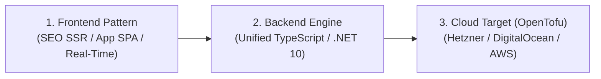
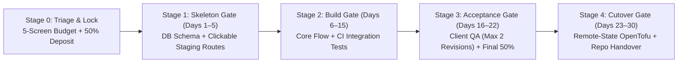

# [Studio Name] — Productized Engineering Catalog

**Production-Ready Web, API & Cloud Systems Delivered in 30 Days.**
*Contact: `[hello@studio.dev]` | Live Showcase: `[https://demo.studio.dev]` | Book a Call: `[Cal.com Link]`*

---

## Why [Studio Name]

* **Fixed Scope, Fixed Price:** No hourly billing surprises or multi-month agency drag.
* **30-Day Delivery Window:** Powered by our 14-day rapid build framework with built-in review, QA, and polish buffers.
* **100% Client Ownership (Zero Lock-In):** You own your custom codebase, database, and cloud account from day one of production.
* **Automated Cloud Infrastructure (OpenTofu):** We provision hardened VPCs, PostgreSQL, SSL, CI/CD, and daily encrypted backups directly into *your* AWS, DigitalOcean, or Hetzner account.
* **Staging-First Security:** All development runs in our isolated staging sandbox; production deployment and repository transfer happen cleanly upon final sign-off.

---

## 1. Base Packages

### Package A: API & Cloud Foundation Sprint

*Ideal for teams with an existing frontend/mobile app, or founders needing a hardened backend and cloud pipeline fast.*

* **Timeline:** 7–10 Days
* **Investment:** **$2,000 USD**
* **Scale Baseline:** Single-node production deployment sized for up to **~500 concurrent active users**
* **What’s Included:**
  * Relational database schema & automated migrations (**PostgreSQL**) + **Redis** caching
  * Production REST / OpenAPI backend (**ASP.NET Core `.NET 10`** or **Node.js / TypeScript**)
  * Authentication & JWT / session security
  * Automated unit & integration test suite on core endpoints + `/api/health` & structured error logging
  * Interactive **Swagger / OpenAPI** documentation
  * Automated daily encrypted PostgreSQL backups
  * Isolated staging environment during build → **OpenTofu** production deploy to client’s cloud + GitHub Actions CI/CD + 10-minute Loom walkthrough
  * **14-day post-launch bug warranty**

---

### Package B: The 30-Day Production MVP Sprint *(Flagship)*

*Ideal for non-technical founders, pre-seed startups, and design agencies going from Figma/spec to live paying users.*

* **Timeline:** 30-Day Delivery Window *(14 active build days + feedback, QA & handover buffer)*
* **Investment:** **$4,500 USD** *(Founding Client Introductory Rate: $3,000–$3,500 for first case studies)*
* **Scale Baseline:** Single-node production deployment sized for up to **~500 concurrent active users**
* **What’s Included:**
  * **Up to 5 Core Screens** (mobile-responsive web UI) + **1 Primary End-to-End User Workflow**
    * *Screen Complexity Budget:* 1 Core Screen = 1 route/view containing up to **1 primary data table or form**, up to **1 modal/drawer**, and up to **3 CRUD/API operations**. *(Multi-tab sub-apps, >3-step wizards, or custom file/PDF pipelines are scoped as additional screens or add-ons.)*
  * Choice of Rendering Pattern (SEO SSR, Interactive SPA, or Real-Time)
  * Authentication (**Google OAuth + Email / Magic Link**) & user profile management
  * Payments & subscriptions (**Stripe Checkout** or **Lemon Squeezy** + webhook sync)
  * Transactional emails (**Resend**: welcome, receipts, auth links)
  * **PostgreSQL** database + automated daily encrypted backups + `/api/health` & error tracking
  * Unit & integration test suite covering critical business flows (auth, billing webhooks, primary CRUD) + CI gate
  * Isolated staging environment during build → Day 30 **OpenTofu** production deploy to client’s cloud
  * 100% IP & GitHub repository transfer + `README` runbook + 10-minute Loom walkthrough
  * **14-day post-launch bug warranty**

---

### Package C: High-Throughput / Fintech & Real-Time Sprint

*Ideal for data-heavy SaaS, trading/analytics portals, or collaborative real-time applications.*

* **Timeline:** 30–45 Days
* **Investment:** **$8,000 – $12,000 USD** *(Scoped by concurrency and integration complexity)*
* **Scale Baseline:** Horizontally scalable deployment engineered for **1,000 – 5,000+ concurrent active users**
* **What’s Included:**
  * Everything in **Package B**, plus:
  * High-throughput **ASP.NET Core (`.NET 10`)** API + **Redis Pub/Sub** & WebSockets / SSE / SignalR
  * **Up to 8 Core Screens** + Workspace Role-Based Access Control (**RBAC**)
  * Stateless app replicas behind a Load Balancer + **PgBouncer** connection pooling
  * Background job workers & async queue processing
  * Audit logging, edge rate limiting, and **k6 / NBomber load & p99 latency verification report**
  * Hardened VPC networking (including AWS ECS/RDS option at no extra cloud surcharge) + automated health & uptime alerting

---

## 2. Architecture Configurator *(3-Step Discovery Call Flow)*

Every Package B or C build is tailored using these three architectural choices:

| Layer | Option 1 | Option 2 | Option 3 |
| :--- | :--- | :--- | :--- |
| **1. Frontend Pattern** | **SEO / Public SaaS** *(Next.js SSR/SSG)* — Best for marketplaces, public content, Google indexing, and OpenGraph cards | **App / Dashboard SPA** *(Vite + React + TypeScript)* — Best for private B2B tools, portals, and zero-flicker client state | **Real-Time Collaborative** *(Next.js/React + WebSockets/SSE)* — Best for live feeds, chat, and instant notifications |
| **2. Backend Engine** | **Unified TypeScript** *(Next.js API / Node + Drizzle/Prisma)* — Fastest iteration in a single TypeScript codebase | **High-Performance `.NET 10`** *(ASP.NET Core + EF Core)* — Strict type safety, high concurrency, fintech-ready *(Standard in Package C; available in Package B)* | — |
| **3. Cloud Target *(OpenTofu)*** | **Hetzner Cloud** *(~$5–$20/mo client bill; included in base)* — Best performance-per-dollar for bootstrappers | **DigitalOcean** *(~$15–$40/mo client bill; included in base)* — Simple managed databases and droplets | **AWS (VPC + ECS/EC2 + RDS)** *(~$60–$150/mo client bill; +$700 on Pkg A/B, included in Pkg C)* — Standard for VC-backed & enterprise teams |

---

## 3. Modular Customization Add-Ons

Requests outside the base package are quoted transparently from this menu so timelines and budgets stay predictable:

### Product, Auth & UI

| Add-On | Scope Covered | Price | Timeline Impact |
| :--- | :--- | :---: | :---: |
| **Additional Screens** | Custom UI screen + backend endpoint + validation | **+$400 / screen** | +1–2 days |
| **Multi-Tenancy & Team RBAC** | Workspaces/Orgs, invite links, Admin / Member / Viewer roles | **+$900** | +3 days |
| **Marketplace / Stripe Connect** | Multi-party payouts, seller onboarding, platform fee split | **+$1,200** | +4 days |
| **Admin Super-Dashboard** | Internal panel to view users, override plans, inspect metrics | **+$800** | +2–3 days |
| **UI/UX Design Pack** | *(If client has no Figma)* Custom Tailwind/Shadcn design system + wireframes | **+$800** | +3–4 days |
| **Gate 0: Existing Codebase & Data Triage** | *(Required ONLY if migrating live users/DB/existing code)* 48-hour security, schema & auth audit + migration plan *(**100% credited** toward sprint if signed)* | **$500** | 2 days (pre-sprint) |

### AI, Data, Scale & Integrations

| Add-On | Scope Covered | Price | Timeline Impact |
| :--- | :--- | :---: | :---: |
| **AWS VPC + ECS/RDS Cloud Pack** | Production AWS OpenTofu setup (VPC, IAM, ECS/EC2, RDS Postgres, ALB) for Package A or B *(included free in Package C)* | **+$700** | +2 days |
| **High-Concurrency & Load-Test Pack** | Scale Package B to **1,000–5,000+ concurrent users**: Load Balancer, stateless replicas, `PgBouncer`, Redis caching, Cloudflare rate limits, and **k6 / NBomber** load-test report | **+$1,500** | +4 days |
| **AI / LLM Pipeline** | OpenAI/Anthropic integration, streaming responses, prompt guards, usage metering | **+$1,000** | +3 days |
| **RAG / Document Search** | File upload, chunking, `pgvector` embeddings, semantic search | **+$1,400** | +4–5 days |
| **Background Workers & Cron** | Async job queue (report exports, scheduled syncs, batch emails) | **+$700** | +2 days |
| **3rd-Party API / Webhook Sync** | Custom integration (Slack, HubSpot, Shopify, Twilio, custom webhooks) | **+$600 / integration** | +2 days |

---

## 4. Post-Launch Care & Retainer Plans

All packages include a **14-day post-launch bug warranty**. After Day 14, choose between self-management or an optional monthly retainer:

| Plan | Monthly Price | What’s Included |
| :--- | :---: | :--- |
| **Self-Managed Handover** | **$0 / mo** | Full source code, OpenTofu scripts, and runbook transferred. Client manages their own server, backups, and updates after the 14-day warranty. *(Post-warranty ad-hoc or emergency incident support is billed at **$100/hr, 4-hour / $400 minimum block**, subject to availability.)* |
| **Peace of Mind *(Infra & DB)*** | **$450 / mo** | 24/7 uptime monitoring + alerts, verified daily PostgreSQL backups, OS/security patches, SSL/domain checks, and priority bug fixes. |
| **Growth Sprint Retainer** | **$1,500 / mo** | Everything in *Peace of Mind* + **10–15 hours/month** of dedicated feature development, UI iterations, and new integrations. |

---

## 5. Staged Gate Delivery & Commercial Terms

### The 5-Stage Gate Calendar (30-Day Window)

Every project advances through five hard engineering gates — work never moves to the next stage until the current gate is signed off:

* **Stage 0 (Pre-Sprint) — Qualification & Lock:** Confirm Greenfield vs. Gate 0 Triage ($500), lock the 5-Screen Complexity Budget in Exhibit A, and clear the 50% Deposit.
* **Stage 1 (Days 1–5) — Architecture & Skeleton Gate:** Approve 1-page DB schema & API brief; deploy clickable route skeleton to `staging-[client].[studio.dev]`. **Exit Gate:** Week 1 Scope Freeze sign-off.
* **Stage 2 (Days 6–15) — Core Build & Test Gate:** Implement frontend screens, backend APIs, auth, Stripe test-mode webhooks, and pass automated CI integration tests.
* **Stage 3 (Days 16–22) — Staging Acceptance Gate:** Client tests live on staging (evaluated on sandbox/test-mode credentials so third-party KYC delays never block acceptance); team completes **up to 2 consolidated rounds of in-scope UI/copy revisions**. **Exit Gate:** Staging sign-off & Final 50% payment cleared.
* **Stage 4 (Days 23–30) — Production Cutover & Warranty Gate:** Run `provision-infra.yml` (`tofu apply` with remote encrypted R2/S3 state) into client’s cloud, cut over DNS, transfer GitHub repo, deliver Loom walkthrough, and start the **14-day bug warranty** (Days 30–44).

### Standard Commercial Terms

1. **50 / 50 Milestone Payment & Rails:**
   * **50% non-refundable deposit** to lock the sprint slot and begin Stage 1.
   * **50% final balance** due upon Stage 3 staging sign-off, prior to production OpenTofu deployment and GitHub repository transfer.
   * **Payment Rails:** Standard invoices are payable via **Wise, Bank Wire, or USDC/USDT (0% surcharge)**. Credit card payments via Stripe incur a **+3.5% processing fee**.
2. **Client-Owned Accounts & Ephemeral Staging:**
   * Clients always pay their own cloud (Hetzner/DigitalOcean/AWS) and third-party API (Stripe/Resend) bills directly on their company card using scoped API tokens.
   * Staging (`staging-*`) is an ephemeral test sandbox using test-mode keys; staging test data is wiped and not migrated to production.
3. **Full IP Assignment:**
   * Upon final payment, the client owns 100% of custom application code, database schemas, and domain assets. Generic studio OpenTofu/boilerplate templates are licensed perpetually for the client's project.
4. **Out-of-Scope Protection:**
   * New features requested after Stage 1 scope freeze are quoted from Section 3 as add-ons or queued for a Phase 2 sprint so the 30-day launch date never slips.

### Explicit Exclusions *(Not Included Unless Scoped Separately)*

* **Native Mobile Binaries:** All MVPs ship as responsive web applications (desktop & mobile browsers); native iOS/Android App Store & Play Store builds are not included.
* **In-Place Spaghetti / AI-Codebase Patching:** If you bring an existing prototype (v0, Lovable, Cursor) with **no live user data**, we treat it purely as a visual spec and rebuild cleanly on our hardened Golden Template under Package B (zero inherited tech debt). If you have **live production users/DB data** to migrate, **Gate 0 Triage ($500)** is required before quoting migration scope.
* **Bulk Data Entry & Legacy CSV Cleaning:** Studio seeds system defaults and 5–10 sample rows; manual entry of product catalogs or cleaning unformatted spreadsheets is excluded.
* **Copywriting & Brand Identity:** Client supplies final brand logos, marketing copy, and domain names (or adds the UI/UX Design Pack for wireframes/design system).
* **Formal Compliance Certifications:** Using Stripe Checkout keeps payment handling minimal-PCI, but formal third-party audits (SOC 2, HIPAA, ISO 27001, external pentests) are outside sprint scope.
* **Paid Third-Party Subscriptions:** Client pays all recurring cloud hosting, domain, LLM token, and SaaS API bills directly.
